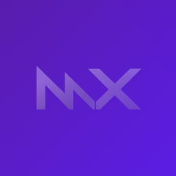

  

<h1 align="center">metalX</h1>

  Run Windows apps on your Mac, export them as native <code>.app</code> / <code>.dmg</code>, and choose your graphics API, all from one minimalist window.

---

## Features

- **EXE to App / DMG:** drop in a Windows `.exe` and export it as a macOS `.app`, or as a `.dmg` with the standard drag-to-Applications layout.
- **Graphics API selector:** pick **D3DMetal**, **DXMT**, **DXVK** or **WineD3D (OpenGL)** from a dropdown, with a short description of each.
- **Steam launcher:** one click sets up a dedicated Windows bottle, downloads the Steam installer and launches Steam.
- **Metal HUD toggle:** show Apple's Metal performance overlay.
- **Automatic setup:** on first launch, metalX offers to download and install Wine in the background, then downloads the graphics APIs (DXMT, DXVK, D3DMetal). Anything you already have is skipped.
- **Automatic updates:** when a newer release is available, metalX shows an "Update required" popup and replaces itself with the new version.
- **Minimal SF Pro interface:** native SwiftUI, nothing extra.

## Requirements

- macOS 13 or later
- Apple Silicon

## Download and install

1. Download the latest **metalX.dmg** from the [Releases](../../releases) page.
2. Open it and drag **metalX** into **Applications**.
3. The first time, right-click the app and choose **Open**.
4. On first launch, click **Install** in the "Install Dependencies" popup. Wine (about 230 MB) is downloaded and installed in the background. Click **Finish** when it's done.
5. A "Download Graphic APIs" popup follows. Click **Download** to get DXMT, DXVK and D3DMetal (about 260 MB in total). D3DMetal requires Rosetta 2 (`softwareupdate --install-rosetta`).

## Usage

1. Drop a `.exe` onto the window, or click the drop area to choose one.
2. Choose a **Graphics API**.
3. Press **Run** to launch it, or **Export .app** / **Export .dmg** to package it.
4. Press **Steam (Windows bottle)** to set up and launch Steam.

Exported apps contain a copy of the `.exe`'s folder and a launcher that runs it in its own Wine bottle with your chosen graphics API. The folder is copied in full, so large games make large apps.

## Graphics APIs

| Option | Best for | Notes |
|---|---|---|
| **D3DMetal** | DirectX 11 / 12 | Apple's translation layer, downloaded as a Game Porting Toolkit build. Runs in its own Wine and bottle. Needs Rosetta 2. |
| **DXMT** | DirectX 10 / 11 | Metal-native. Experimental. |
| **DXVK** | DirectX 9 / 10 / 11 | Runs through Vulkan (MoltenVK). |
| **WineD3D (OpenGL)** | Fallback | Built into Wine. Slowest, but works out of the box. This is the default. |

metalX copies the right files into the bottle and sets the DLL overrides for you when you pick an API.

## Data locations

- Wine: `~/Library/Application Support/metalX/Wine`
- Bottles: `~/Library/Application Support/metalX/Bottles`
- Backend files: `~/Library/Application Support/metalX/Backends`

To uninstall completely, delete the app and that `metalX` folder.

## Known limitations

- Not every Windows app or game will run, and performance varies by title and graphics API.
- Apps that need an NVIDIA GPU or driver (for example, the NVIDIA App) will not work.
- Anti-cheat and kernel-level drivers generally don't work under Wine.
- D3DMetal, DXVK and DXMT come from third-party builds and their compatibility varies by game.

## Credits

Made by **OptimisaGH**.

metalX relies on third-party projects, each under its own license:

- [Wine](https://www.winehq.org) and the macOS builds by [Gcenx](https://github.com/Gcenx/macOS_Wine_builds)
- [DXVK](https://github.com/doitsujin/dxvk) and [DXMT](https://github.com/3Shain/dxmt)
- Apple's Game Porting Toolkit / D3DMetal

metalX is not affiliated with or endorsed by Apple, Microsoft, Valve, NVIDIA or the Wine project. All trademarks belong to their respective owners.

## License

Copyright (c) 2026 OptimisaGH. **All Rights Reserved.**

metalX is proprietary, closed-source software. You may download and use the released app for personal use. You may not copy, modify, redistribute, reverse engineer or sell it without prior written permission from the copyright holder. See [LICENSE](LICENSE.md).
